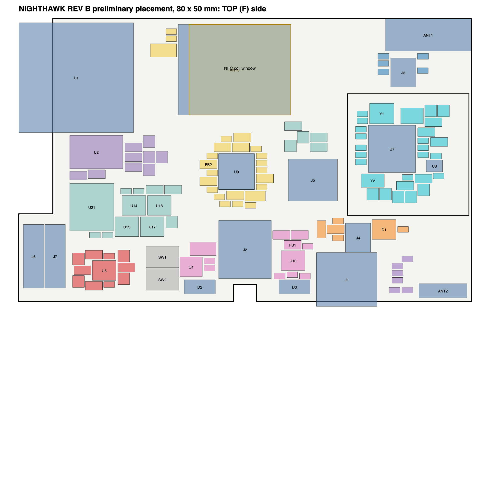
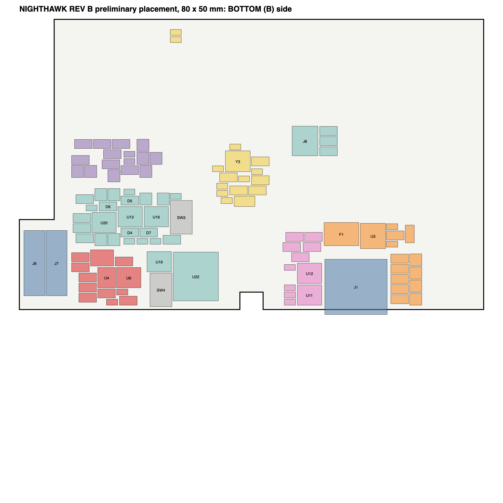
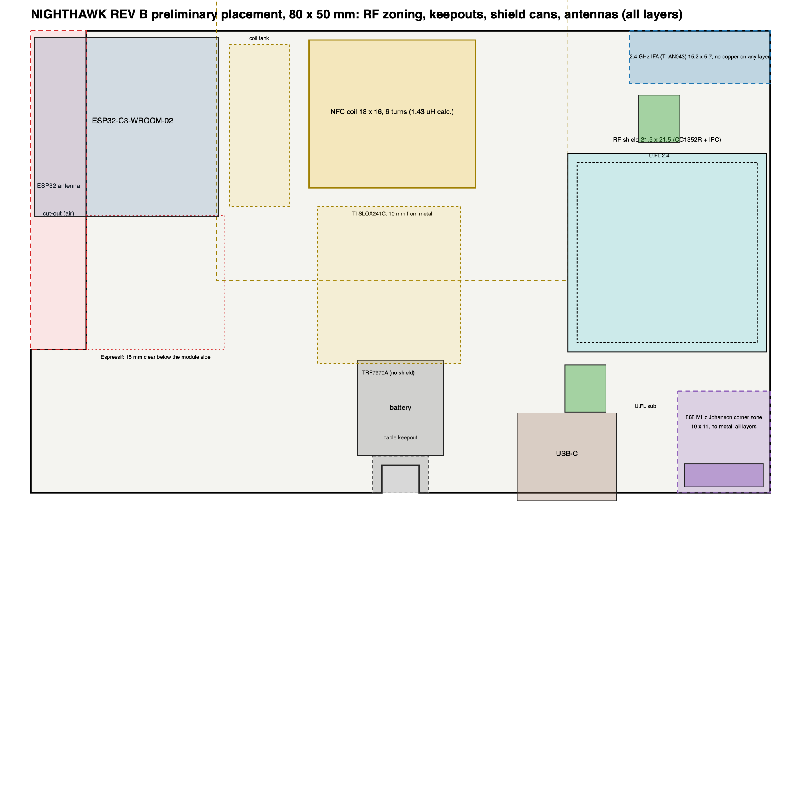
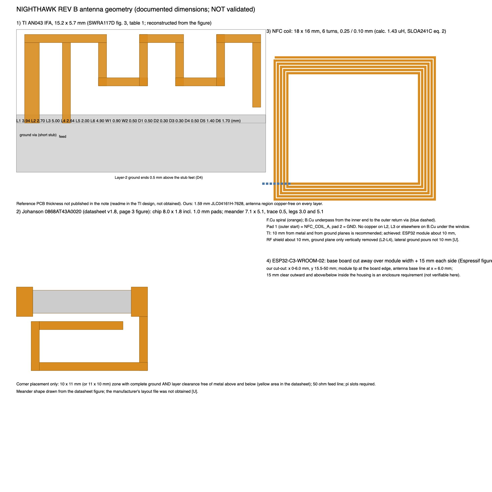

# NIGHTHAWK: ESL security research instrument (KiCad hardware, firmware, AI-assisted routing)

**Role: Hardware and firmware designer** · Nov 2026 to present · work in progress

> 🇹🇷 **Özet:** NIGHTHAWK, elektronik raf etiketi (ESL) sistemlerinin güvenlik araştırması için tasarladığım taşınabilir bir ölçüm cihazı. REV A (ESP32-C3 + iki RF genişleme yuvası) şematik ve PCB olarak tamamlandı, üretilmedi. REV B, tek kartta 2.4 GHz + 868 MHz + 13.56 MHz NFC + IR bağlantısını birleştiren 80×50 mm, 4 katmanlı bir tasarım: şematik ve yerleşim tamam, **yönlendirme (routing) henüz tamamlanmadı**. Hiçbir kart üretilmedi, güç verilmedi, ölçülmedi. Bu depo her şeyi (şematikler, üretici betikleri, mühendislik raporları, firmware, masaüstü uygulaması ve AI destekli routing altyapısı) dürüst durum notlarıyla birlikte içerir.

> **Status, stated plainly:** nothing in this repository has been fabricated, powered up or measured. Every antenna, RF-matching and coexistence number is a datasheet value, a hand calculation or an assumption, and is labelled that way in the documents. No claim of antenna performance, RF compliance or production readiness is made. REV B routing is **not finished**, and no Gerbers are published for REV B.

## What it is

A bench instrument for studying electronic shelf label (ESL) links on equipment you own, with the radio paths kept measurable (U.FL test points, tunable matching networks) and a **hardware interlock that keeps every RF path off by default**.

**Intended use:** owned equipment only, conducted or shielded testing, passive measurement. The firmware refuses to start a session when the hardware interlock is open. The repository contains **no ESL command generation** and no attack code; the research documents are desk research from public sources.

| Revision | State | What it is |
|---|---|---|
| **REV A** | schematic and PCB complete, ERC 0 violations, DRC 0 errors, not fabricated | ESP32-C3-WROOM-02 main board, two modular RF expansion slots, passive RF test path, hardware interlock |
| **REV B** | schematic and placement done, **routing in progress** | one integrated 80×50 mm 4-layer board: ESP32-C3, TI CC1352R (2.4 GHz and 868 MHz), TRF7970A NFC, 940 nm IR link, hardware interlock |

## REV B at a glance

| Block | Parts |
|---|---|
| **Controller** | ESP32-C3-WROOM-02 (on-board antenna keepout per Espressif, 15 mm) |
| **Sub-GHz and 2.4 GHz radio** | TI CC1352R1F3RGZR, Johanson 0900PC15A0036 IPC (2.4 GHz and sub-GHz from one RF port pair), 868 MHz chip antenna, 2.4 GHz inverted-F antenna (TI AN043 geometry), U.FL test connectors, tunable pi/L matching networks |
| **NFC** | TI TRF7970A, 18×16 mm 6-turn PCB coil (calculated 1.43 µH, not measured) |
| **Optical link** | 940 nm IR LED and photodiode |
| **Power** | LiPo, BQ24074 charger, TPS63802 buck-boost, USB-C |
| **Safety** | hardware interlock (default RF off), independent RF power gating, ESP32 to CC1352R time-slot coordination lines |
| **Fabrication target** | JLCPCB JLC04161H-7628 4-layer stackup, black mask, HASL with lead, cost-optimised |

<p align="center"> </p>
<p align="center"> </p>

### Engineering approach

Every document labels its evidence: **[DS]** manufacturer datasheet read, **[CALC]** calculation (script included), **[ASM]** assumption, **[MEAS]** measurement (none exist yet). Highlights:

- **Component gate and passive selection** for every RF part, with the datasheet pages used ([`REV_B_COMPONENT_GATE.md`](RevB/REV_B_COMPONENT_GATE.md), [`REV_B_PASSIVE_SELECTION.md`](RevB/REV_B_PASSIVE_SELECTION.md)).
- **RF design gate**: ESP32 to CC1352R coexistence, CC1352R input-power protection margins on a no-loss basis (the 1.3 dB discrepancy between two earlier tables is explained), 868 MHz corner keepout, NFC coil guidance, feed-line stackup ([`REV_B_RF_DESIGN_GATE.md`](RevB/REV_B_RF_DESIGN_GATE.md)).
- **Pre-routing resolutions**: USB-C and Johanson IPC footprints rebuilt from manufacturer drawings, battery connector and shield-frame dimensions checked ([`REV_B_PRE_ROUTING_RESOLUTIONS.md`](RevB/REV_B_PRE_ROUTING_RESOLUTIONS.md)).
- **Antenna design notes** with the TI AN043 inverted-F geometry and its keepouts on all four layers ([`REV_B_ANTENNA_ENGINEERING_R2.md`](RevB/REV_B_ANTENNA_ENGINEERING_R2.md)).
- **Mandatory prototype measurements** are listed rather than assumed away: S21 of the IPC path before the first transmission, antenna return loss, coil inductance and Q, time-slot coexistence.

### Routing status (honest)

- **Done and DRC-clean:** RF paths routed programmatically (`RevB/pcb/rf_route_b.py`): CC1352R to IPC differential pairs, both antenna feed chains with matching-network nodes, U.FL taps, ground vias. The 868 MHz feed uses a short B.Cu hop where the 2.4 GHz and sub-GHz feeds would otherwise cross.
- **Not done:** the rest of the board. With **In1 kept as a pure GND reference plane**, Freerouting 2.5.0 leaves about 200 nets unrouted on the current placement; allowing it to route on In1 reaches ~85 unrouted but breaks the plane, which is not acceptable here. The honest options are a looser placement or a larger board; that is a design decision still open.
- **Controlled impedance is not claimed.** The 50 Ω width (0.359 mm over L2, calculator result for the JLC stackup) is a number, not a validated geometry; the 2.4 GHz diff-pair necks are not 50 Ω.

## AI-assisted routing infrastructure (`RevB/ai_routing/`)

An experiment in driving KiCad and an autorouter through MCP, with engineering-grade checks instead of trust in the autorouter.

- **kicad-mcp-pro 4.9.0** and the **official Freerouting 2.5.0 MCP server**, run locally and offline (no design data leaves the machine).
- Tested on a copy, on a 16-net subset: both paths completed 20 of 20 connections (about 126 mm, 17 vias), **but** the router drew signal tracks on the GND plane and ignored custom DRC rules. Full report: [`RevB/ai_routing/REPORT.md`](RevB/ai_routing/REPORT.md).
- Problems found and documented: KiCad 10.0.6's CLI has no headless DSN export (pcbnew's Python API is used), kicad-mcp-pro's Freerouting command adds a `-drc` flag that makes 2.5.0 skip routing, Freerouting's MCP advertises an `outputSchema` but returns no `structuredContent` (a wrapper strips it), and one environment variable made kicad-mcp-pro hang at start-up.
- Recommended architecture: RF paths scripted and locked, the rest routed by class, and a gate that fails if any signal track appears on the GND plane.
- Handshake evidence and the continuing plan: `RevB/ai_routing/results/handshake_evidence.md`, `RevB/ai_routing/HANDOFF_PHASES.md`.

## Repository layout

| Path | Contents |
|---|---|
| `Hardware/` | REV A KiCad project (`NIGHTHAWK.kicad_pro`, 11 sheets, PCB) and `build/` generator scripts (`design.py` is the single source of parts and nets) |
| `Firmware/` | PlatformIO + ESP-IDF project: CLI over USB, interlock monitor, I/O expander, ADC, microSD, device database. Not compiled on hardware |
| `Software/desktop_app/` | PySide6 companion app |
| `Documentation/` | REV A reports, pin assignment, parts verification, race and watchdog reviews, `Research/` (ESL protocol desk research, TagTinker review, licence audit) |
| `RevB/` | REV B design documents, `schematic/` (7 sheets, generator scripts), `pcb/` (board generator, RF routing, routing and verification scripts), `integrated/` (RF calculations), `ai_routing/` |
| `README_REV_A.md` | the original REV A readme |

Manufacturing outputs (Gerbers, JLCPCB packages) and bulky generated test boards are deliberately not published.

## Rebuild (REV B)

Run with KiCad 10's bundled Python:

```
cd RevB/schematic && python3 gen_footprints_b.py && python3 gen_sch_b.py
cd ../pcb && python3 make_board_b.py      # board with placement
python3 rf_route_b.py                      # programmatic RF routing
python3 verify_r2.py                       # keepout verification on all layers
```

## What is not done

Routing of the full REV B board · antenna and matching validation · any measurement · firmware on hardware · Gerber release · RF compliance. Each of these is an open item, not a hidden assumption.

---

*Product and component names belong to their owners (Espressif, Texas Instruments, Johanson Technology, Würth Elektronik, JST, JLCPCB and others). The research notes cite public sources (Furrtek, PrecIR, TagTinker); their licences are audited in `Documentation/Research/REUSE_AND_LICENSE_AUDIT.md`. No licence is granted for this repository yet; all rights reserved by the author until one is chosen.*
